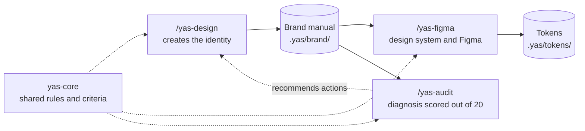

<div align="center">

# Yas Design System

**Branding and design systems with Claude Code:**
from an idea to a documented, audited brand that is ready for Figma.


[Español](README.md) · **English**

[Installation](#installation) · [Quick start](#quick-start) · [The skills](#the-skills) · [Generated files](#generated-files) · [Status](#status-and-roadmap)

</div>

---

> **Note on language:** this README is a translation. The skills themselves (their instructions, questions, and the documents they generate) are written in **Spanish**, and some command arguments are Spanish words (for example `identidad-verbal`). Claude follows the skill instructions in Spanish, so expect Spanish conversations and deliverables.

## Contents

- [What is it?](#what-is-it)
- [The skills](#the-skills)
- [Installation](#installation)
- [Quick start](#quick-start)
- [Generated files](#generated-files)
- [Shared quality rules](#shared-quality-rules)
- [Status and roadmap](#status-and-roadmap)
- [Repository structure](#repository-structure)
- [References and inspiration](#references-and-inspiration)
- [Contributing](#contributing)
- [License](#license)

## What is it?

Yas Design is **not a collection of prompts**: it is a **design methodology** packaged as [Claude Code](https://claude.com/claude-code) skills. Each skill analyzes, decides, executes, documents, and validates, and leaves **real files** in your project.

- **A process with approval gates.** Every phase has an objective, what to do, what to ask, a deliverable, and an approval criterion. When it finishes, it summarizes and waits for your sign-off before moving on.
- **Three specialists that share results.** What one skill creates, the others read; nothing is redone or copied.
- **Verifiable honesty.** It separates what was verified from hypotheses and from what it could not verify, and never claims something is validated if it did not run the check.
- **It keeps working when Figma fails.** Without the Figma MCP, or without quota, it generates the system locally with a navigable HTML ready to deliver.



---

## The skills

| Skill | Responsibility | Commands |
|---|---|---|
| **`/yas-design`** | **Create** the identity: new brand or rebranding, up to the brand manual | `init` · `brief` · `brand` · `rebrand` |
| **`/yas-audit`** | **Audit** the brand and score it out of 20. It only diagnoses; it never fixes | `estrategia` (strategy) · `identidad-verbal` (verbal identity) · `competencia` (competition) · `identidad-visual` (visual identity) · `consistencia` (consistency) · `digital` (digital presence) · `sistema` (brand system) |
| **`/yas-figma`** | **Generate** the design system from the manual and take it to Figma, or document it | `mini` · `full` · `push` · `documentation` · `colors` |
| **`yas-core`** | Shared core (not invoked directly): rules, artifacts, tokens, quality, and references | — |

> **Scope rule:** each skill does the kind of work you asked for and does not move on to the next without it being part of the request. An audit does not redesign; a conceptual proposal does not turn into code; the next useful step is **offered**, not run on its own.

### `/yas-design` — from idea to brand

It starts by asking where you are starting from:

| Starting point | What happens |
|---|---|
| **New brand** | You pick the type of brand mark (wordmark, symbol, combination mark, or emblem), or let Yas Design propose one based on the brief, with a justification and your approval |
| **Rebranding** | Initial assessment of the existing brand and the scope of change: **adjustment**, **evolution**, or **full rebrand**. It does not assume everything must change |

The full process is a set of **phases with an approval gate**:

| Phase | Content |
|---|---|
| 0 · 0b | Preparation and scope · *(rebranding)* initial assessment of the existing brand |
| 1 | Brief and strategy |
| 2 | Research and competitor documentation |
| 3 | Concept exploration (radial diagrams, three concepts) |
| 4 | Sketches and selection |
| 5 | Building the brand mark in SVG, one-color first |
| 6 · 7 | Color · Typography |
| 8 · 8b | Brand versions and assets · Iconography (style, grid, base SVG set) |
| 9 | Brand applications |
| 10 · 10b | Brand manual (Markdown and HTML) · *(rebranding)* transition plan |
| 11 | Final check and delivery |

### `/yas-audit` — diagnosis scored out of 20

It does not stop at saying whether a logo "looks good": it **detects problems, justifies every finding, and proposes prioritized improvements.** Seven independent modules feed five categories, each scored from 0 to 4:

| Scored category | Modules |
|---|---|
| 1 · Strategy and positioning | Strategy · Verbal identity · Competition |
| 2 · Visual identity | Visual identity |
| 3 · Brand consistency | Consistency |
| 4 · Digital experience | Digital presence |
| 5 · Technical evaluation of assets | Brand system |

**Bands:** 18–20 Excellent · 14–17 Good · 10–13 Acceptable · 6–9 Poor · 0–5 Critical.

Each finding includes **problem, evidence, impact, priority** (critical, high, medium, or low, with explicit criteria), **recommendation, and validation**. The skill also separates what is **verified**, what is a **hypothesis**, and what is **not verified**: if it cannot render or open something, it does not claim a visual validation. Hypotheses do not subtract points.

### `/yas-figma` — from the manual to the design system

Every value comes from the **brand manual** (the one `/yas-design` generates or one you attach). Colors and fonts are never invented as placeholders.

| Command | What it does |
|---|---|
| `/yas-figma mini` | Generates the **Mini Design System**: foundations only, in 9 pages |
| `/yas-figma full` | Generates the **Full Design System**: foundations, components, patterns, and templates, in 28 pages |
| `/yas-figma push` | **Loads into Figma a design system already generated** earlier by `mini` or `full`. It is idempotent and resumable: if it is cut off by a usage limit, the next `push` continues where it stopped |
| `/yas-figma documentation figma <URL>` | Reads a Figma file (read-only) and generates the **design system HTML** from its real data |
| `/yas-figma documentation manual` | Generates the **design system HTML** from a brand manual only, without touching Figma |
| `/yas-figma colors` | Turns the brand palette into color tokens and **semantic variables** (light and dark) |

**What each scope includes:**

| | **Mini** (9 pages) | **Full** (28 pages) |
|---|---|---|
| Pages | Cover · Icons · Brand assets · Colors · Type scale · Spacing and layout · Radios · Shadows · Grids | Cover · foundations (Brand, Color, Iconography, Images, Layout and spacing, Shadows and effects, Typography, Motion) · 16 components · Components - App · Patterns · Templates and applications |
| Intended for | MVP, prototype, or new brand | Existing product or several teams |

> **Without the Figma MCP, or without quota:** `mini` and `full` warn you with the specific reason and generate the local package (`.yas/figma-local/`) with `design-system.html`, variables, styles, and a guide to build it by hand. Once an MCP is available, `push` loads it into Figma. `documentation figma` is the exception: if it cannot read Figma, it reports the problem and stops.

> **Figma Starter teams (3 pages per file; drafts have no such limit):** the skill detects it when Figma returns the error and offers four options: use a file in Drafts, upgrade the plan, create the page structure manually, or generate only icons, color, and typography.
>
> **Figma file:** the skill writes only to the file you point it to (URL) or the one saved in `.yas/figma-state.json`; it never creates files on its own. To save MCP read quota, it checks and verifies inside `use_figma`.

---

## Installation

The four skills (`yas-core`, `yas-design`, `yas-audit`, and `yas-figma`) **always go together**: they reference each other with relative paths and `yas-core` is required. Install all four, never just one.

**Option A · With `npx skills` (recommended)**

It uses the [`skills`](https://github.com/vercel-labs/skills) installer, which discovers the skills in the repository and installs them for you.

```bash
# In the current project
npx skills add Yasmani-Vinamagua/yas-design-system --all -y -a claude-code

# For all your projects (global install)
npx skills add Yasmani-Vinamagua/yas-design-system --all -y -a claude-code -g
```

To see what the repository contains without installing anything, add `--list`. Do not use `--skill` with a single skill: `yas-core` would be missing.

The installer stores the skills in `.agents/skills/` and leaves links in `.claude/skills/` that point to them. Do not delete `.agents/`: Claude Code would stop finding the skills.

**Option B · Manual copy, for all your projects (global)**

```bash
git clone https://github.com/Yasmani-Vinamagua/yas-design-system.git
```

```bash
# macOS / Linux
mkdir -p ~/.claude/skills
cp -r yas-design-system/.claude/skills/yas-* ~/.claude/skills/
```

```powershell
# Windows (PowerShell)
New-Item -ItemType Directory -Force "$env:USERPROFILE\.claude\skills" | Out-Null
Copy-Item -Recurse yas-design-system\.claude\skills\yas-* "$env:USERPROFILE\.claude\skills\"
```

**Option C · Manual copy, for one project only**

Copy the four `yas-*` folders into `<your-project>/.claude/skills/`.

**Verify:** open a new Claude Code session and type `/yas-`. You should see `/yas-design`, `/yas-audit`, and `/yas-figma` (`yas-core` does not appear because it is not invoked directly).

### Updating

The skills do not update themselves: everyone works with the copy they installed. To get the changes (see [`CHANGELOG.md`](CHANGELOG.md)):

- **Option A (`npx skills`):** run `npx skills update`, or run the install command again.
- **Options B and C:** `git pull` in your clone and copy the `yas-*` folders again.

Your data lives in `.yas/` and is not touched by an update.

### Requirements

| Requirement | Required? |
|---|---|
| [Claude Code](https://claude.com/claude-code) | Yes |
| Figma MCP | **Optional.** Only to create or read Figma files. Without it, `/yas-figma` works in local mode |
| Browser or rendering tools | Optional. They improve the visual validation in `/yas-audit`; without them, the skill reports it as *not verified* |

**Installing the Figma MCP** (following the [official Figma documentation](https://developers.figma.com/docs/figma-mcp-server/remote-server-installation)):

```bash
# Recommended by Figma: the official plugin
claude plugin install figma@claude-plugins-official

# Or the remote MCP server (add --scope user to use it in all projects)
claude mcp add --transport http figma https://mcp.figma.com/mcp
```

Then type `/mcp` in Claude Code to authenticate.

---

## Quick start

**Create a new brand**

```text
/yas-design brand
```
Answer the questions in each phase and approve each phase's deliverable. At the end you will have the brand manual in `.yas/brand/manual/`.

**Redo an existing brand**

```text
/yas-design rebrand
```
Attach the logo, the manual, or the URL. First the current brand is assessed and the scope of change is agreed.

**Audit a brand**

```text
/yas-audit
```
Attach the material (logo, manual, URL, project path). It audits all modules, or a specific one: `/yas-audit digital`.

**Generate the design system and take it to Figma**

```text
/yas-figma mini                        # foundations: 9 pages
/yas-figma full                        # complete system: 28 pages
/yas-figma push                        # load an already generated system into Figma
/yas-figma documentation manual        # design system HTML from the manual
/yas-figma documentation figma <URL>   # HTML from a Figma file
/yas-figma colors                      # just the palette, as semantic variables
```

---

## Generated files

Everything lives in `.yas/` inside your project, and the skills share these files instead of copying them.

```text
.yas/
├── brand/                        ← /yas-design
│   ├── marca-spec.md             specification and decision log
│   ├── investigacion/  concepto/
│   ├── logo/                     SVG: master and variants
│   ├── paleta/paleta.md          color table (HEX, RGB, CMYK, Pantone reference)
│   ├── tipografia/  iconografia/  aplicaciones/
│   └── manual/manual-identidad.{md,html}
├── tokens/                       ← /yas-figma
│   ├── tokens.json               DTCG format, primitives and semantics, light and dark
│   ├── contraste.md              color pairs with their computed WCAG ratio
│   └── CHANGELOG.md
├── figma-local/                  ← /yas-figma mini and full
│   └── design-system.html        navigable deliverable
├── deliverables/                 ← /yas-figma documentation
├── audits/YYYY-MM-DD-marca.md    ← /yas-audit
└── figma-state.json              Figma progress, to resume
```

File and folder names inside `.yas/` are in Spanish, because the skills are.

---

## Shared quality rules

All three skills follow the same eight rules (`yas-core`):

| Rule | Behavior |
|---|---|
| **Initial inspection** | Reviews existing files, structure, and technologies before acting |
| **Context** | Identifies the project and its constraints before intervening |
| **Execution** | Solves what was asked without triggering unnecessary processes |
| **Files** | Creates or modifies real files when the task requires it |
| **Protection** | Does not overwrite existing files without checking their purpose |
| **Quality** | Validates results with the available tools |
| **Documentation** | Records decisions, usage instructions, and relevant changes |
| **Transparency** | Reports what it generated, what it verified, and what is still pending |

---

## Status and roadmap

The project is in **beta**. The skills are designed and reviewed, but they do not yet have an automated test suite, and the Figma integration depends on the real behavior of the MCP. If you find something broken, please open an issue.

| Status | Feature |
|---|---|
| Available | `/yas-design` (`init`, `brief`, `brand`, `rebrand`) · `/yas-audit` (seven modules) · `/yas-figma` (`mini`, `full`, `push`, `documentation`, `colors`) |
| Not implemented | Importing from Figma into code, syncing Figma with code, Code Connect, and bringing code screens into Figma. The skill says so clearly if they are requested |
| Known limitations | Skills are in Spanish only · creating variables, styles, and pages in Figma depends on the MCP tools and your plan · audits of real perception need data that you provide |

---

## Repository structure

```text
.claude/skills/
├── yas-core/        common rules, artifacts, token specification, quality criteria, references
├── yas-design/      SKILL.md + phased process, logo construction, manual template
├── yas-audit/       SKILL.md + audit modules
└── yas-figma/       SKILL.md
```

---

## References and inspiration

The skills consult these sources as **references for method and organization, not as models to imitate**:

- **Documentation and brand:** [IBM Design Language](https://www.ibm.com/design/language/) · [Wolff Olins](https://www.wolffolins.com/work) · [Google Brand Resource Center](https://partnermarketinghub.withgoogle.com/brands/google/overview/) · [Logo Design Love](https://www.logodesignlove.com/lego-logo) · [Adobe Illustrator](https://www.adobe.com/es/learn/illustrator)
- **Components and platforms:** [Material Design 3](https://m3.material.io/) · [Apple Human Interface Guidelines](https://developer.apple.com/design/human-interface-guidelines/)
- **Brand audit:** [AAMA](https://americanadvertisingandmarketingassociation.org/resources/creative-brand-resources/brand-audit-editable-brand-strategy-identity-audit-template-aama/) · [Smartsheet](https://www.smartsheet.com/content/brand-audit-templates) · [Beyond Basics](https://beyondbasics.studio/resources/brand-audit-guide/) · [Brandfolder](https://brandfolder.com/resources/brand-audit-templates/)
- **Complementary tools:** [WAVE](https://wave.webaim.org/) · [Lighthouse](https://developer.chrome.com/docs/lighthouse/overview?hl=es-419)

> This project is independent and **not affiliated** with Figma, Google, Apple, IBM, Adobe, or any of the organizations mentioned. Names belong to their respective owners.

---

## Contributing

Contributions are welcome: open an *issue* with the problem or proposal, or a small, focused *pull request*. To keep the ecosystem coherent:

- Each topic is defined **once** in `yas-core` and the skills reference it; do not duplicate documentation.
- Respect the **scope rule**: a skill must not do more than it announces.
- If you add a feature, state its status (available, partial, or not implemented) and do not claim as verified anything you have not tested.

---

## License

Distributed under the [MIT](LICENSE) license. You may use, copy, modify, and distribute the project, keeping the copyright notice and the license.
