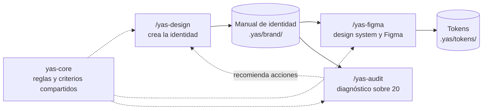

<div align="center">

# Yas Design System

**Branding y sistema de diseño con Claude Code:**
de la idea a una marca documentada, auditada y lista para Figma.


**Español** · [English](README.en.md)

[Instalación](#instalación) · [Inicio rápido](#inicio-rápido) · [Las skills](#las-skills) · [Qué genera](#qué-archivos-genera) · [Estado](#estado-y-hoja-de-ruta)

</div>

---

## Índice

- [¿Qué es?](#qué-es)
- [Las skills](#las-skills)
- [Instalación](#instalación)
- [Inicio rápido](#inicio-rápido)
- [Qué archivos genera](#qué-archivos-genera)
- [Reglas de calidad compartidas](#reglas-de-calidad-compartidas)
- [Estado y hoja de ruta](#estado-y-hoja-de-ruta)
- [Estructura del repositorio](#estructura-del-repositorio)
- [Referencias e inspiración](#referencias-e-inspiración)
- [Contribuir](#contribuir)
- [Licencia](#licencia)

## ¿Qué es?

Yas Design **no es una colección de prompts**: es una **metodología de diseño** empaquetada como skills de [Claude Code](https://claude.com/claude-code). Cada skill analiza, decide, ejecuta, documenta y valida, y deja **archivos reales** en tu proyecto.

- **Proceso con puertas de aprobación.** Cada fase tiene objetivo, qué hacer, qué preguntar, entregable y criterio de aprobación. Al terminar, resume y espera tu visto bueno antes de avanzar.
- **Tres especialistas que comparten resultados.** Lo que crea una skill lo leen las otras; nada se rehace ni se copia.
- **Honestidad verificable.** Distingue lo comprobado de las hipótesis y de lo que no pudo verificar, y nunca declara validado lo que no ejecutó.
- **Funciona aunque Figma falle.** Sin el MCP de Figma, o sin cuota, genera el sistema en local con un HTML navegable listo para entregar.



---

## Las skills

| Skill | Responsabilidad | Comandos |
|---|---|---|
| **`/yas-design`** | **Crear** la identidad: marca nueva o rebranding, hasta el manual de identidad | `init` · `brief` · `brand` · `rebrand` |
| **`/yas-audit`** | **Auditar** la marca y puntuar sobre 20. Solo diagnostica, nunca corrige | `estrategia` · `identidad-verbal` · `competencia` · `identidad-visual` · `consistencia` · `digital` · `sistema` |
| **`/yas-figma`** | **Generar** el design system a partir del manual y llevarlo a Figma, o documentarlo | `mini` · `full` · `push` · `documentation` · `colors` |
| **`yas-core`** | Núcleo compartido (no se invoca): reglas, artefactos, tokens, calidad y referencias | — |

> **Regla de alcance:** cada skill hace el tipo de trabajo que pediste y no pasa al siguiente sin que forme parte de lo solicitado. Una auditoría no rediseña; una propuesta conceptual no se convierte en código; el siguiente paso útil se **ofrece**, no se ejecuta por su cuenta.

### `/yas-design` — de la idea a la marca

Empieza preguntando el punto de partida:

| Punto de partida | Qué ocurre |
|---|---|
| **Marca nueva** | Eliges el tipo de marca gráfica (logotipo, isotipo, imagotipo o isologo) o dejas que Yas Design lo proponga según el brief, con justificación y tu aprobación |
| **Rebranding** | Evaluación inicial de la marca existente y alcance del cambio: **ajuste**, **evolución** o **rebranding integral**. No se asume que todo deba cambiar |

El proceso completo son **fases con puerta de aprobación**:

| Fase | Contenido |
|---|---|
| 0 · 0b | Preparación y alcance · *(rebranding)* evaluación inicial de la marca existente |
| 1 | Brief y estrategia |
| 2 | Investigación y documentación de la competencia |
| 3 | Exploración conceptual (diagramas radiales, tres conceptos) |
| 4 | Bocetos y selección |
| 5 | Construcción de la marca gráfica en SVG, primero a una tinta |
| 6 · 7 | Color · Tipografía |
| 8 · 8b | Versiones y activos de marca · Iconografía (estilo, cuadrícula, set base en SVG) |
| 9 | Aplicaciones de marca |
| 10 · 10b | Manual de identidad (Markdown y HTML) · *(rebranding)* plan de transición |
| 11 | Control final y entrega |

### `/yas-audit` — diagnóstico con puntuación sobre 20

No se limita a decir si un logo «se ve bien»: **detecta problemas, justifica cada hallazgo y propone mejoras priorizadas.** Siete módulos independientes alimentan cinco categorías, cada una de 0 a 4:

| Categoría puntuada | Módulos |
|---|---|
| 1 · Estrategia y posicionamiento | Estrategia · Identidad verbal · Competencia |
| 2 · Identidad visual | Identidad visual |
| 3 · Consistencia de marca | Consistencia |
| 4 · Experiencia digital | Presencia digital |
| 5 · Evaluación técnica de los activos | Sistema de marca |

**Bandas:** 18–20 Excelente · 14–17 Bueno · 10–13 Aceptable · 6–9 Pobre · 0–5 Crítico.

Cada hallazgo incluye **problema, evidencia, impacto, prioridad** (crítica, alta, media o baja, con criterios explícitos), **recomendación y validación**. Además, la skill separa lo **comprobado**, las **hipótesis** y lo **no verificado**: si no puede renderizar o abrir algo, no afirma haberlo validado visualmente. Las hipótesis no restan puntos.

### `/yas-figma` — del manual al design system

Todos los valores salen del **manual de identidad** (el que genera `/yas-design` o el que tú adjuntes). Nunca se inventan colores ni fuentes de relleno.

| Comando | Qué hace |
|---|---|
| `/yas-figma mini` | Genera el **Mini Design System**: solo fundamentos, en 9 páginas |
| `/yas-figma full` | Genera el **Full Design System**: fundamentos, componentes, patrones y plantillas, en 28 páginas |
| `/yas-figma push` | **Carga a Figma un design system ya generado** antes por `mini` o `full`. Es idempotente y reanudable: si se corta por límite de uso, el siguiente `push` continúa donde se quedó |
| `/yas-figma documentation figma <URL>` | Lee un archivo de Figma (solo lectura) y genera el **HTML del design system** con sus datos reales |
| `/yas-figma documentation manual` | Genera el **HTML del design system** solo a partir de un manual de identidad, sin tocar Figma |
| `/yas-figma colors` | Convierte la paleta de la marca en tokens de color y **variables semánticas** (claro y oscuro) |

**Qué incluye cada alcance:**

| | **Mini** (9 páginas) | **Full** (28 páginas) |
|---|---|---|
| Páginas | Cover · Icons · Brand assets · Colors · Type scale · Spacing and layout · Radios · Shadows · Grids | Cover · fundamentos (Brand, Color, Iconography, Images, Layout and spacing, Shadows and effects, Typography, Motion) · 16 componentes · Components - App · Patterns · Templates and applications |
| Pensado para | MVP, prototipo o marca nueva | Producto existente o varios equipos |

> **Sin el MCP de Figma, o sin cuota:** `mini` y `full` avisan con el motivo concreto y generan el paquete local (`.yas/figma-local/`) con `design-system.html`, variables, estilos y una guía para implementarlo a mano. Cuando haya MCP, `push` lo carga a Figma. `documentation figma` es la excepción: si no puede leer Figma, anuncia el problema y termina.

> **Equipos Starter de Figma (3 páginas por archivo; los borradores no tienen ese límite):** la skill lo detecta cuando Figma devuelve el error y te ofrece cuatro opciones: usar un archivo en Drafts, ampliar el plan, crear la estructura de páginas manualmente, o generar solo iconos, color y tipografía.
>
> **Archivo de Figma:** la skill escribe solo en el archivo que le indicas (URL) o en el guardado en `.yas/figma-state.json`; no crea archivos por su cuenta. Para ahorrar cuota de lectura del MCP, comprueba y verifica dentro de `use_figma`.

---

## Instalación

Las cuatro skills (`yas-core`, `yas-design`, `yas-audit` y `yas-figma`) **van siempre juntas**: se referencian entre sí con rutas relativas y `yas-core` es obligatoria. Instala las cuatro, nunca una sola.

**Opción A · Con `npx skills` (recomendada)**

Usa el instalador [`skills`](https://github.com/vercel-labs/skills), que descubre las skills del repositorio y las instala por ti.

```bash
# En el proyecto actual
npx skills add Yasmani-Vinamagua/yas-design-system --all -y -a claude-code

# Para todos tus proyectos (instalación global)
npx skills add Yasmani-Vinamagua/yas-design-system --all -y -a claude-code -g
```

Para ver qué contiene el repositorio sin instalar nada, añade `--list`. No uses `--skill` con una sola skill: faltaría `yas-core`.

El instalador guarda las skills en `.agents/skills/` y deja en `.claude/skills/` enlaces que apuntan a ellas. No borres `.agents/`: Claude Code dejaría de encontrar las skills.

**Opción B · Copia manual, para todos tus proyectos (global)**

```bash
git clone https://github.com/Yasmani-Vinamagua/yas-design-system.git
```

```bash
# macOS / Linux
mkdir -p ~/.claude/skills
cp -r yas-design-system/.claude/skills/yas-* ~/.claude/skills/
```

```powershell
# Windows (PowerShell)
New-Item -ItemType Directory -Force "$env:USERPROFILE\.claude\skills" | Out-Null
Copy-Item -Recurse yas-design-system\.claude\skills\yas-* "$env:USERPROFILE\.claude\skills\"
```

**Opción C · Copia manual, solo en un proyecto**

Copia las cuatro carpetas `yas-*` dentro de `<tu-proyecto>/.claude/skills/`.

**Verifica:** abre una sesión nueva de Claude Code y escribe `/yas-`. Deberían aparecer `/yas-design`, `/yas-audit` y `/yas-figma` (`yas-core` no aparece porque no se invoca directamente).

### Actualizar

Las skills no se actualizan solas: cada persona trabaja con la copia que instaló. Para recibir los cambios (consulta el [`CHANGELOG.md`](CHANGELOG.md)):

- **Opción A (`npx skills`):** ejecuta `npx skills update`, o vuelve a lanzar el comando de instalación.
- **Opciones B y C:** haz `git pull` en tu clon y vuelve a copiar las carpetas `yas-*`.

Tus datos están en `.yas/` y no se tocan al actualizar.

### Requisitos

| Requisito | ¿Obligatorio? |
|---|---|
| [Claude Code](https://claude.com/claude-code) | Sí |
| MCP de Figma | **Opcional.** Solo para crear o leer archivos de Figma. Sin él, `/yas-figma` trabaja en modo local |
| Navegador o herramientas de renderizado | Opcional. Mejoran la validación visual de `/yas-audit`; sin ellas, la skill lo declara como *no verificado* |

**Instalar el MCP de Figma** (según la [documentación oficial de Figma](https://developers.figma.com/docs/figma-mcp-server/remote-server-installation)):

```bash
# Recomendado por Figma: el plugin oficial
claude plugin install figma@claude-plugins-official

# O el servidor MCP remoto (añade --scope user para usarlo en todos los proyectos)
claude mcp add --transport http figma https://mcp.figma.com/mcp
```

Después, escribe `/mcp` en Claude Code para autenticarte.

---

## Inicio rápido

**Crear una marca nueva**

```text
/yas-design brand
```
Responde a las preguntas de cada fase y aprueba el entregable de cada una. Al final tendrás el manual de identidad en `.yas/brand/manual/`.

**Rehacer una marca existente**

```text
/yas-design rebrand
```
Adjunta el logo, el manual o la URL. Primero se evalúa lo que hay y se acuerda el alcance del cambio.

**Auditar una marca**

```text
/yas-audit
```
Adjunta el material (logo, manual, URL, ruta del proyecto). Audita todos los módulos, o uno concreto: `/yas-audit digital`.

**Generar el design system y llevarlo a Figma**

```text
/yas-figma mini                    # fundamentos: 9 páginas
/yas-figma full                    # sistema completo: 28 páginas
/yas-figma push                    # cargar a Figma un sistema ya generado
/yas-figma documentation manual    # HTML del design system desde el manual
/yas-figma documentation figma <URL>   # HTML a partir de un archivo de Figma
/yas-figma colors                  # solo la paleta, como variables semánticas
```

---

## Qué archivos genera

Todo vive en `.yas/` dentro de tu proyecto, y las skills comparten estos archivos en lugar de copiarlos.

```text
.yas/
├── brand/                        ← /yas-design
│   ├── marca-spec.md             especificación y registro de decisiones
│   ├── investigacion/  concepto/
│   ├── logo/                     SVG: maestro y variantes
│   ├── paleta/paleta.md          tabla de colores (HEX, RGB, CMYK, Pantone de referencia)
│   ├── tipografia/  iconografia/  aplicaciones/
│   └── manual/manual-identidad.{md,html}
├── tokens/                       ← /yas-figma
│   ├── tokens.json               formato DTCG, primitivas y semánticas, claro y oscuro
│   ├── contraste.md              pares de color con su ratio WCAG calculado
│   └── CHANGELOG.md
├── figma-local/                  ← /yas-figma mini y full
│   └── design-system.html        entregable navegable
├── deliverables/                 ← /yas-figma documentation
├── audits/AAAA-MM-DD-marca.md    ← /yas-audit
└── figma-state.json              progreso de Figma, para reanudar
```

---

## Reglas de calidad compartidas

Las tres skills cumplen las mismas ocho reglas (`yas-core`):

| Regla | Comportamiento |
|---|---|
| **Inspección inicial** | Revisa archivos, estructura y tecnologías existentes antes de actuar |
| **Contexto** | Identifica el proyecto y sus restricciones antes de intervenir |
| **Ejecución** | Resuelve lo pedido sin activar procesos innecesarios |
| **Archivos** | Crea o modifica archivos reales cuando la tarea lo requiere |
| **Protección** | No sobrescribe archivos existentes sin comprobar su función |
| **Calidad** | Valida los resultados con las herramientas disponibles |
| **Documentación** | Registra decisiones, instrucciones de uso y cambios relevantes |
| **Transparencia** | Informa qué generó, qué verificó y qué quedó pendiente |

---

## Estado y hoja de ruta

El proyecto está en **beta**. Las skills están diseñadas y revisadas, pero todavía no tienen una batería de pruebas automatizadas, y la integración con Figma depende del comportamiento real del MCP. Si encuentras algo roto, abre un issue.

| Estado | Funcionalidad |
|---|---|
| Disponible | `/yas-design` (`init`, `brief`, `brand`, `rebrand`) · `/yas-audit` (siete módulos) · `/yas-figma` (`mini`, `full`, `push`, `documentation`, `colors`) |
| Sin implementar | Importar de Figma al código, sincronizar Figma con el código, Code Connect y llevar pantallas del código a Figma. La skill lo indica con claridad si se piden |
| Limitaciones conocidas | Solo en español · la creación de variables, estilos y páginas en Figma depende de las herramientas del MCP y de tu plan · las auditorías de percepción real necesitan datos que tú aportes |

---

## Estructura del repositorio

```text
.claude/skills/
├── yas-core/        reglas comunes, artefactos, especificación de tokens, criterios de calidad, referencias
├── yas-design/      SKILL.md + proceso por fases, construcción del logo, plantilla del manual
├── yas-audit/       SKILL.md + módulos de auditoría
└── yas-figma/       SKILL.md
```

---

## Referencias e inspiración

Las skills consultan estas fuentes como **referencias de método y de organización, no como modelos a imitar**:

- **Documentación y marca:** [IBM Design Language](https://www.ibm.com/design/language/) · [Wolff Olins](https://www.wolffolins.com/work) · [Google Brand Resource Center](https://partnermarketinghub.withgoogle.com/brands/google/overview/) · [Logo Design Love](https://www.logodesignlove.com/lego-logo) · [Adobe Illustrator](https://www.adobe.com/es/learn/illustrator)
- **Componentes y plataformas:** [Material Design 3](https://m3.material.io/) · [Apple Human Interface Guidelines](https://developer.apple.com/design/human-interface-guidelines/)
- **Auditoría de marca:** [AAMA](https://americanadvertisingandmarketingassociation.org/resources/creative-brand-resources/brand-audit-editable-brand-strategy-identity-audit-template-aama/) · [Smartsheet](https://www.smartsheet.com/content/brand-audit-templates) · [Beyond Basics](https://beyondbasics.studio/resources/brand-audit-guide/) · [Brandfolder](https://brandfolder.com/resources/brand-audit-templates/)
- **Herramientas complementarias:** [WAVE](https://wave.webaim.org/) · [Lighthouse](https://developer.chrome.com/docs/lighthouse/overview?hl=es-419)

> Este proyecto es independiente y **no está afiliado** a Figma, Google, Apple, IBM, Adobe ni a ninguna de las organizaciones citadas. Los nombres pertenecen a sus propietarios.

---

## Contribuir

Las contribuciones son bienvenidas: abre un *issue* con el problema o la propuesta, o un *pull request* pequeño y enfocado. Para mantener la coherencia del ecosistema:

- Cada tema se define **una sola vez** en `yas-core` y las skills lo referencian; no dupliques documentación.
- Respeta la **regla de alcance**: una skill no debe hacer más de lo que anuncia.
- Si añades una función, indica en qué estado está (disponible, parcial o sin implementar) y no declares como verificado lo que no has probado.

---

## Licencia

Distribuido bajo la licencia [MIT](LICENSE). Puedes usar, copiar, modificar y distribuir el proyecto, conservando el aviso de copyright y la licencia.
